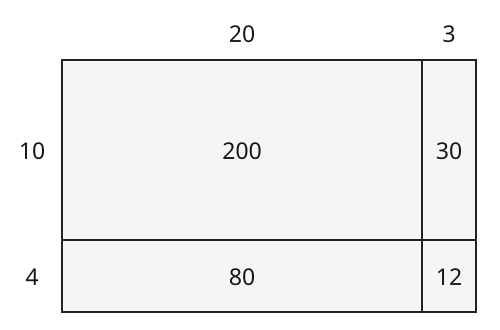

# Four-region multiplication

Grade 4 · Partial products and stacked rows

Standard [4.NBT.B.5](https://www.thecorestandards.org/Math/Content/4/NBT/B/5/)

Grade 4 multiplication covers whole numbers of up to four digits by one digit and two digits by two digits. The Grade 4 standards for number and operations in base ten are limited to whole numbers at most 1,000,000. This record uses one two-digit-by-two-digit product. [Common Core State Standards for Mathematics, p. 29](https://corestandards.org/wp-content/uploads/2023/09/ADA-Compliant-Math-Standards.pdf#page=29)

## Area model for 23 × 14

What is 23 × 14? Draw a rectangle 23 units wide and 14 units tall, using the same scale in both directions. Split its width by place value, 23 = 20 + 3, and its height, 14 = 10 + 4. Each region gives one partial product by multiplying one width by one height.



The column headings give widths in units. The row headings give heights in units. The four areas are in square units.

| Height | Left width 20 | Right width 3 |
|---|---|---|
| Top 10 | 20 × 10 = 200 | 3 × 10 = 30 |
| Bottom 4 | 20 × 4 = 80 | 3 × 4 = 12 |

By the distributive property, `23 × 14 = (20 + 3) × (10 + 4) = 200 + 30 + 80 + 12 = 230 + 92 = 322`. The four regions cover the rectangle once, so its area is **322 square units** and the product is **322**.

## Parent bridge

In a familiar stacked calculation, the bottom regions combine to make 23 × 4 = 80 + 12 = 92. The top regions combine to make 23 × 10 = 200 + 30 = 230. The 1 in 14 represents one ten, so the second row records 23 tens, or 230. Grouping the four partial products into these two rows uses the same distributive property. Align hundreds, tens, and ones to add the two rows.

```text
   23
×  14
─────
   92  (23 × 4)
+ 230  (23 × 10)
─────
  322
```

Fluency with the standard multiplication algorithm is a Grade 5 expectation under [5.NBT.B.5](https://www.thecorestandards.org/Math/Content/5/NBT/B/5/). [Common Core State Standards for Mathematics, p. 35](https://corestandards.org/wp-content/uploads/2023/09/ADA-Compliant-Math-Standards.pdf#page=35)

## Check by compensation

Use 15 groups of 23 and take away one group. First find 23 × 15 = 23 × 10 + 23 × 5 = 230 + 115 = 345. Then `23 × (15 − 1) = 345 − 23 = 322`, which agrees with the sum of the two stacked rows.

## Two incorrect records for 23 × 14

| Erroneous record | First difference |
|---|---|
| The splits are 20 + 3 and 10 + 4. The four areas are recorded as 200, 30, 60, and 12, with a scratch total of 302. The answer field shows 322. | The lower-left region is the first error. Its area is 20 × 4 = 80. The answer field agrees with the correct product, while the recorded area and scratch total need correction. |
| The splits are 20 + 3 and 10 + 4. The four areas are recorded as 200, 30, 80, and 12, with a scratch total of 312. The answer field also shows 312. | The four areas agree with the model. The first error is the sum. Adding 200 + 30 + 80 + 12 gives 322. |
