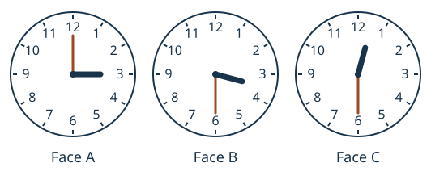

# Where is the short hand at half past?

Grade 1 · G13 · Concept `time` · MP6. Read and write whole hours and half-hours. [Goal and standard, p. 16](../../goals/grade-1.md#g13-reading-hours-and-half-hours)

## Reading the two hands

**1.MD.B.3.** A long **minute hand** shows how far the clock has moved through an hour. The short **hour hand** moves along with it. What would a digital clock show for each face?

| Face | Read the minute hand | Read the hour hand | Write the time |
|---|---|---|---|
| A | At 12, a new hour has just started. Zero minutes have passed. | Exactly on 3. | **3:00**, three o'clock. |
| B | At 6, halfway around from 12. Thirty minutes have passed. | Halfway from 3 to 4. Three is the last hour reached. | **3:30**, half past three. |
| C | At 6, halfway around. | Halfway from 12 to 1. Twelve is the last hour reached. | **12:30**, half past twelve. |

**Parent bridge.** Follow the minute hand clockwise from the top of A to the bottom of B. Half a turn takes half of sixty minutes, so the display changes from 00 to 30 after the colon. During that same time, the hour hand travels half of the short distance from 3 to 4.

## Drawing from a digital time

Start with each display, placing both hands from the center of a blank face. At **3:00**, draw the long hand straight up to 12 and the short hand pointing right at 3. At **3:30**, draw the long hand straight down to 6. Start the short hand at 3 and swing it halfway toward 4. At **12:30**, keep the long hand down and place the short hand halfway from 12 toward 1.

Check the drawings with the displays covered. The two downward minute hands both give thirty minutes. Of their short hands, the one just past 3 identifies B as **3:30**, and the one just past 12 identifies C as **12:30**. On the remaining face the upward minute hand and the short hand exactly at 3 give **3:00**.
