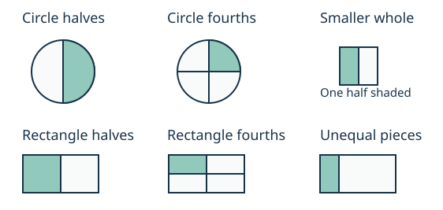

# Half of which whole?

Grade 1 · Halves and fourths

Split a circle or rectangle into two or four parts of equal area.

## Two cuts through the center of a disk

**[1.G.A.3](https://www.thecorestandards.org/Math/Content/1/G/A/3/).** The reference whole is **one round paper disk**. The first two circles in the drawing show copies of the same disk. How much of that disk does each shaded piece cover?

On the first disk, a straight cut runs from the top through the center to the bottom. It makes two **halves**. Give the shaded piece a half-turn about the center. Its straight edge and curved edge fit the other piece exactly, so the areas match. Put the halves together along the cut. The two curved edges rebuild the entire rim and the two pieces fill the disk.

On the second disk, a second cut runs from left to right through the center at a square corner to the first cut. It splits each half into two matching pieces. Give the shaded piece a quarter-turn at a time. In four positions it fills the four regions exactly once. Each region is **a fourth of the disk**, also called **a quarter of the disk**. Two neighboring fourths fit the original half. On this same whole, a quarter covers less area than a half.

**Parent bridge.** Point to the single shaded piece in the second disk. “A quarter of the disk” and “a fourth of the disk” name that very same share. Four copies fit around the center to rebuild the whole disk.

## Checking shares of a rectangle

**[1.G.A.3](https://www.thecorestandards.org/Math/Content/1/G/A/3/).** Now the reference whole is **one wide paper rectangle**, four small square-widths across and two square-heights tall. The bottom row shows three copies. Each covers eight small squares' worth of paper.

| Copy | Where the cuts fall | Check the shares and rebuild |
|---|---|---|
| Left | One upright cut halfway across. | Slide the left piece onto the right. Each covers two columns of two small squares, four each. Slide it back. **Two halves** meet along one full edge and fill all eight squares. |
| Middle | The upright middle cut and a horizontal cut halfway up. | Each piece covers two small squares in one row. Slide any piece onto any other. **Four fourths** fit as two on top and two below. All eight squares are covered once. |
| Right | One upright cut after the first column. | The narrow piece covers two small squares and the wide piece covers six. They rebuild the rectangle, but their areas differ. Calling each a half would assign the same name to unequal shares of that whole. |

For the wide rectangle, one half covers four small squares and one quarter covers two. The half holds exactly two of its quarters. Now change the whole. The **smaller square** at the upper right is two small squares across and two tall. Half of this smaller whole covers two small squares. A quarter of the wide rectangle also covers two. Turn the narrow shaded half to fit that quarter exactly. The words *half* and *quarter* tell how a particular whole was divided. To compare the amounts, identify both wholes.
