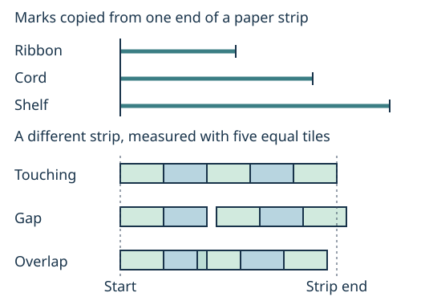

# Which span reaches farther?

Grade 1 · G12 · Concepts `length`, `order` · MP3, MP5. Compare three lengths and measure an exact whole number of equal units. [Goal and standards, p. 16](../../goals/grade-1.md#g12-comparing-length-indirectly-and-measuring-by-iteration)

## Carrying lengths to one strip

**1.MD.A.1.** A ribbon is fixed to a board and a shelf is fixed to a wall. Which is longer? A piece of cord reaches past the end of the ribbon when their starts line up. When its start is lined up with the shelf's start, the cord stops short of the shelf's end. The cord fits between the two lengths. The **ribbon is shorter than the cord, and the cord is shorter than the shelf**, so the shelf is longer than the ribbon.

Check the order with a paper strip long enough for all three. Carry the strip to each object, place its starting edge at one end of the object and mark the other end. The upper drawing copies those three spans onto separate rows so the end marks can be read from a common start. The ribbon mark comes first, then the cord mark, then the shelf mark.

## When five tiles measure the strip

**1.MD.A.2.** In the lower drawing, the two dashed guides mark the ends of a different strip. The length unit is the width of one tile. How many tile-widths long is the strip?

In the **touching** row, the left edge of tile one lies on the start guide. Each right edge meets the next left edge. The right edge of tile five lies on the far guide. The whole strip is covered once, so its length is **5 tile-widths**. Count the intervals between the six tile edges to check.

In the **gap** row, the first two tiles touch. There is a space before tile three. All five tiles still have the same width. The outside ends now span five tile-widths **plus the gap**, and the last tile reaches past the strip end. A piece of strip between tiles two and three is bare.

In the **overlap** row, tile three starts before tile two ends. Their shared patch is covered twice. The outside ends now span five tile-widths **less the overlap**, leaving the right end of the strip bare. Counting five tiles gives the same count in all three rows. Only the touching row matches both endpoints and covers every interval exactly once.

**Parent bridge.** Imagine lifting the touching tiles and leaving a mark at each edge. On a ruler, each space from one mark to the next represents one unit. From the first mark to the sixth there are five such spaces.
