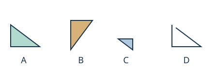
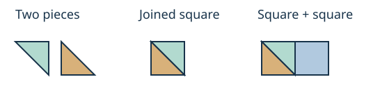
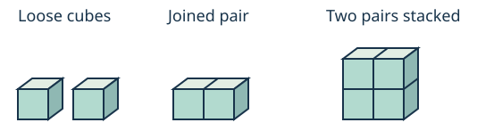

# Which edges belong to the shape?

Grade 1 · Defining attributes and composition

Classify plane shapes by their defining attributes and build new plane and solid shapes in two stages.

## Building and drawing a triangle

**[1.G.A.1](https://www.thecorestandards.org/Math/Content/1/G/A/1/).** Lay one long straight stick across the table. At its left end, place a shorter straight stick pointing up. Join the two free ends with a third straight stick of the length needed to close the outline. Trace each stick from corner to corner, returning to the starting point. The drawing is triangle A below. Its three straight sides close around a region and meet at three corners. These are **defining attributes** of a triangle.

Which other outlines are triangles? B is a quarter-turn of A, with a different fill. Trace its three sides back to the starting corner. C is smaller and turned again. The same trace closes in three sides. Color, size and which way a corner points are **incidental attributes** here. In D, follow all three sticks. The last tip stops short of the first at the upper left. Three straight sticks can make an open path, so **D fails the closure check**.

**Parent bridge.** Turn the paper under A. Each meeting of two sides moves with the paper. All three corners stay joined, which explains why the turned drawing is still a triangle.

## A square becomes a piece of a rectangle

**[1.G.A.2](https://www.thecorestandards.org/Math/Content/1/G/A/2/).** Start with two matching paper triangles. Each is half of a square cut from corner to corner. What can we build if there is also a whole square of the same size as that original square?

1. Bring the two long sloping edges together along their entire length. Four short edges now trace the four sides of **one square**. The diagonal is an internal **seam**, the line where the pieces meet.
2. Keep the joined square together. Place the whole square against its right side, edge to edge. The new outside shape is **a rectangle two square-widths across and one high**. The old diagonal and the new upright seam are both inside it.

Check in reverse. Trace the top, right end, bottom and left end without turning inward along a seam. Lift off the right square along the upright seam. The left square is the one made in step one. Open it along the diagonal to recover both original triangles.

## A pair of cubes becomes a layer

**[1.G.A.2](https://www.thecorestandards.org/Math/Content/1/G/A/2/).** Four identical toy cubes are available. What box can we build by first making a pair? Each cube has six square faces. The sloping edges in the drawing show depth.

1. Press two cubes together so one full square face of each meets. The result is a box two cubes wide, one high and one deep. The two touching faces are hidden inside. Make a second pair the same way with the other two cubes.
2. Lift the second pair as **one piece** and set it squarely on the first. The whole bottom of the upper pair meets the whole top of the lower pair. The final box is two cubes wide, two high and one deep.

Check the outside and then take it apart. The front is a square made of four small square faces, with one vertical seam and one horizontal seam. The back matches the front. Each end, the top and the bottom show two small square faces apiece. This accounts for sixteen exposed small faces. Lifting the top layer restores two pairs. Pulling each pair apart recovers four cubes. Their four face-to-face joins in the stacked box hide eight of the original twenty-four small faces, leaving the same sixteen on the outside.
