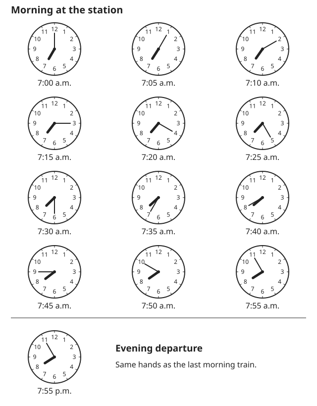

# Where are both hands at five to eight?

Grade 2 · G24 · Concepts `time` · MP6. [Goal and standards, p. 20](../../goals/grade-2.md#g24-five-minute-clock-readings-and-times-of-day)

## Twelve five-minute readings

**2.MD.C.7.** The long thin hand counts minutes around the dial. The short thick hand measures progress through the hour. At half past it is halfway between two numbers, as on the [Grade 1 clock faces](../grade-1/clock-faces.md). What do the two hands tell us between seven and eight on a morning at the station?

Read the morning faces from left to right, one row at a time. For the minutes, count five for each numeral spacing past 12. For the hour, start with the numeral the short hand has most recently reached.

| Long hand at | Digital reading | Long hand at | Digital reading |
|---:|---|---:|---|
| 12 | 7:00 a.m. | 6 | 7:30 a.m. |
| 1 | 7:05 a.m. | 7 | 7:35 a.m. |
| 2 | 7:10 a.m. | 8 | 7:40 a.m. |
| 3 | 7:15 a.m. | 9 | 7:45 a.m. |
| 4 | 7:20 a.m. | 10 | 7:50 a.m. |
| 5 | 7:25 a.m. | 11 | 7:55 a.m. |

Read the other direction from **7:20 a.m.** Four five-minute steps take the long hand to 4. Twenty minutes is one third of an hour, so the short hand travels one third of the way from 7 to 8. At **7:55** the long hand points to 11. The short hand has traveled eleven of twelve equal steps toward 8. Five minutes remain before it reaches 8, so the hour still reads seven.

## Two trains at five to eight

**2.MD.C.7.** The morning train departs at the last morning face. Write **7:55 a.m.** The evening train departs at the separate evening face. Write **7:55 p.m.** On both faces the long hand points to 11 and the short hand is just before 8. Checking from the digital display, 55 minutes puts the minute hand five minutes short of a full turn and the hour hand five minutes short of the next hour mark.

**Parent bridge.** Cover the captions on those two faces and the hands give the same time. “Morning train” supplies a.m. and “evening train” supplies p.m. The hands alone give no time of day.
