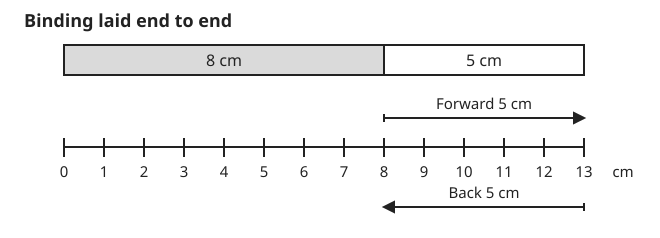

# How far did the endpoint move?

Grade 2 · G23 · Concepts `length`, `model`, `scale`, `add` · MP4. [Goal and standards, p. 20](../../goals/grade-2.md#g23-representing-length-arithmetic-on-a-number-line)

## Two pieces of binding

**2.MD.B.5.** A bookbinder joins an 8 cm piece of binding and a 5 cm piece end to end. How long is the joined strip? The upper band of the drawing shows both pieces, touching once at the seam.

Write 8 cm + 5 cm = □ cm. Two centimeters of the second piece reach 10 cm. Its remaining three reach **13 cm of binding**. Now start with that 13 cm strip and cut off the 8 cm piece. How long is the remaining piece? Write 13 cm − 8 cm = □ cm. From 8 to 10 is 2 cm and from 10 to 13 is 3 cm, so the missing piece measures **5 cm**. Fitting it back gives 8 cm + 5 cm = 13 cm.

## From the seam to the end and back

**2.MD.B.6.** Read the line as distances from zero, with 40 drawing units per centimeter. Consecutive ticks enclose one centimeter each. The seam at 8 lies eight intervals from zero. The far end at 13 lies thirteen intervals from zero.

Start at 8 cm and follow the forward arrow. The five successive landings are 9, 10, 11, 12, 13 cm. The endpoint is **13 cm from zero** and the movement was **5 cm forward**. Follow the return arrow from 13 cm. Its five landings are 12, 11, 10, 9, 8 cm. Thus 13 cm − 5 cm = 8 cm, exactly the starting position.

**Parent bridge.** Point first to zero, then the seam, then the far end. The distances from zero are the first piece (8 cm) and the whole binding (13 cm). The distance between the seam and the far end gives the second piece (5 cm).
