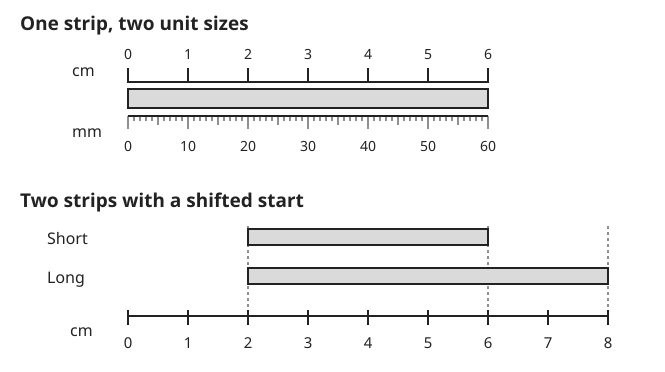

# Where does the measurement begin?

Grade 2 · G22 · Concepts `length`, `scale`, `units`, `add` · MP5. [Goal and standards, p. 20](../../goals/grade-2.md#g22-selecting-a-length-tool-estimating-and-measuring)

## Choosing a tool and testing an estimate

**2.MD.A.1 · 2.MD.A.3.** How close are the estimates to the measured lengths? A **benchmark** is a familiar length used for comparison. A **standard unit** has a fixed size, so different people can reproduce the measurement. These are worked sample measurements.

| Span and benchmark | Estimate | Tool and endpoint reading | Comparison |
|---|---|---|---|
| Short edge of a page, compared with a 1-inch tile | 8 inches | Set a ruler's zero at one corner and read 9 inches at the other. | 9 inches measured, 1 inch longer than estimated. |
| Straight shelf, compared with a 1-foot ruler | 5 feet | Place a yardstick along the edge. Mark its far end at 3 feet, then start its zero there and read 1 more foot. | 4 feet measured, 1 foot shorter than estimated. |
| Curved trim on a bag, compared with a 10-centimeter strip | 30 centimeters | Bend a measuring tape along the trim from zero to the far seam. The end meets 28 centimeters. | 28 centimeters measured, 2 centimeters shorter than estimated. |
| Length of a room, compared with a 1-meter stride | 6 meters | Lay a meter stick along the floor starting at the wall. Move its zero to the last endpoint at each placement. Five lengths reach the other wall. | 5 meters measured, 1 meter shorter than estimated. |

The ruler fits the page in one reading. The yardstick and meter stick cover longer straight spans in fewer placements. The tape follows the curve all the way around the trim. Every reading uses adjacent intervals from one endpoint to the other.

## Two scales on the same strip

**2.MD.A.2.** The two scales in the upper drawing run along the same strip. Both share the same zero and end guide. The drawing uses 60 coordinate units per centimeter and 6 per millimeter. Read its scales at any display size.

Count the six centimeter intervals. Within each, ten smaller millimeter intervals cover exactly the same distance. Counting them by tens reaches 10, 20, 30, 40, 50, **60 millimeters**. The strip is also **6 centimeters** long. A smaller unit takes more copies because the endpoints stay fixed.

## Starting at the two mark

**2.MD.A.4.** Compare the lower strips. Both start at 2 cm. The short strip ends at 6 cm, so it spans 6 cm − 2 cm = **4 cm**. The long strip ends at 8 cm. Count its six intervals, 2–3, 3–4, 4–5, 5–6, 6–7, 7–8. Its length is **6 cm**.

How much longer is the long strip? The exposed portion from 6 to 8 spans **2 cm**. Subtracting the measured lengths agrees, 6 cm − 4 cm = 2 cm. Add it back to check, 4 cm + 2 cm = 6 cm.

**Parent bridge.** On the shifted ruler, 8 cm names the far mark. Subtract the starting mark, 8 cm − 2 cm, to count the six centimeter intervals between the ends.
