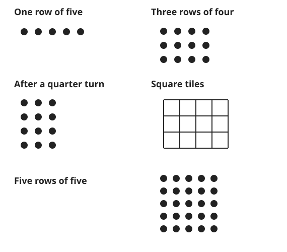

# What does one row count?

Grade 2 · Pairs, arrays and tiled rectangles

## A partner for each counter

**[2.OA.C.3](https://www.thecorestandards.org/Math/Content/2/OA/C/3/).** Lay out nineteen counters in two lines, matching top to bottom. Each column with two counters is a **pair**.

```text
Top      ● ● ● ● ●   ● ● ● ● ●
Bottom   ● ● ● ● ●   ● ● ● ●
```

Count nine pairs by twos to 18. The last top counter has no partner, so **19 is odd**. Add one counter directly under it. Now every top counter has a partner, so **20 is even**. Counting the two complete lines separately gives **20 = 10 + 10**. For any collection up to twenty, making pairs gives the same test. An empty collection leaves zero unpaired and 0 = 0 + 0.

## Rows that turn into columns

**[2.OA.C.4](https://www.thecorestandards.org/Math/Content/2/OA/C/4/).** An **array** lines up objects in rows across and columns down. How many counters are on each mat? Each filled dot in the drawing is one counter.



| Array | Count by complete rows | Check another way |
|---|---|---|
| One row of five | 5 = 5. The row supplies a single addend. | Count the individual dots from one to five. |
| Three rows of four | 4 + 4 + 4 = 12 | Number the objects across the rows, 1–4, 5–8, 9–12. |
| Same mat after a quarter turn | 3 + 3 + 3 + 3 = 12 | Four old columns are now four rows. Each original counter appears once. |

At the five-row, five-column limit, five rows of five counters give **5 + 5 + 5 + 5 + 5 = 25**. Counting by fives reaches 5, 10, 15, 20, 25.

**Parent bridge.** Read a row, then point to its addend. Turning the mat changes how many addends we write and how large each is. All twelve counters turn together.

## Squares inside the rectangle

**[2.G.A.2](https://www.thecorestandards.org/Math/Content/2/G/A/2/).** On the right of the drawing, divide each long edge into four equal lengths and each short edge into three lengths of the same size. Join opposite marks straight across. The lines partition the whole rectangle into three rows of four **square interiors**, each one unit wide and one unit high. Count 4 + 4 + 4 = **12 squares**. Trace a column instead. Each of four columns contains three squares, accounting for every bit of the rectangle exactly once.

The five vertical boundary lines meet the four horizontal boundary lines in 5 + 5 + 5 + 5 = **20 intersections**. A finger on a crossing touches a corner. To count a tile, place the finger inside a square. In the counter array a dot represents an object and the spaces between objects are empty.
