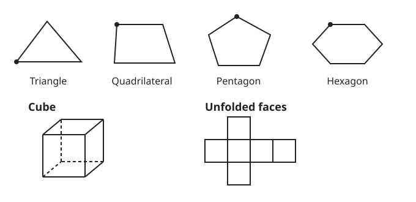
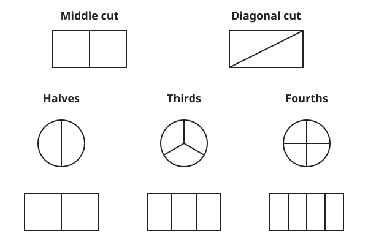

# Can a triangle and a rectangle each be half?

Grade 2 · G21 · Concepts `shape`, `share` · MP3. [Goal and standards, p. 20](../../goals/grade-2.md#g21-classifying-figures-and-checking-equal-shares)

## Drawing from the attributes

**2.G.A.1.** What shape fits a request for five straight sides and five angles? Join five points around a closed outline with straight segments, turning once at each point. Trace the drawing from the marked vertex back to the start. Five turns and five sides identify the **pentagon**. The same construction with three, four or six vertices gives the other plane figures shown below. An angle is formed where two sides meet.

| Request | Drawing that fits | Check |
|---|---|---|
| Three angles | Triangle | Trace three straight sides and three corners. |
| Four angles | Quadrilateral | Trace four straight sides, including the sloping one. |
| Five angles | Pentagon | A fifth side closes the outline at the marked vertex. |
| Six angles | Hexagon | Each of the six turns leads to a different side. |
| Six equal square faces on a solid | Cube | Four squares in a belt wrap around the sides. The two remaining squares close the top and bottom. |

To draw the cube, sketch two matching squares slightly offset and join the corresponding corners. The dashed edges pass behind the solid. The neighboring **net**, a flat arrangement of faces, checks what the perspective sketch hides. Slide any one of its squares onto another and all four edges match. Folding the net gives six equal square faces.

## Halves that take different shapes

**2.G.A.3.** Two identical paper rectangles each need to be shared equally between two people. Cut the first down the middle. Each piece has four sides and four right angles, so it is a rectangle. Here the four sides also match, making it a square. Cut the second from one corner to its opposite. Each piece has three sides and three angles including a right angle, a triangle.

Slide one middle-cut rectangle onto the other. Their edges match. In the diagonal cut, turning one triangle halfway around the rectangle's center matches the other triangle. Each pair fits its original paper with the cut edges together, leaving no gap or overlap. Thus each piece covers half the area of its whole.

**Parent bridge.** Lay the two whole sheets on top of one another before cutting. Their outside edges coincide. One rectangular half and one triangular half each cover half that much paper. Equal area is enough for equal shares, including pieces whose outlines do not match.

## Naming the shares and the whole

**2.G.A.3.** The lower drawings keep every circle the same size and every rectangle the same size as the rectangles above. In each column, how many equal pieces rebuild one whole?

| Cut | Circle | Rectangle | Rebuilt whole |
|---|---|---|---|
| Halves | A diameter cuts two equal semicircles. | The middle line gives two equal strips. | One half and one half are two halves, one whole. |
| Thirds | Three radii spaced by equal turns about the center give three equal sectors. | Two parallel cuts make three strips of equal width and height. | Three thirds make one whole. |
| Fourths | Two perpendicular diameters give four equal sectors. | Three parallel cuts make four strips of equal width and height. | Four fourths, or four quarters, make one whole. |

Check a circle by turning one sector around its center in equal steps. After two half-turns, three one-third turns or four quarter-turns, it has covered the circle exactly once. Slide a rectangle strip sideways by its width in the same way. The last far edge meets the far edge of the original sheet.
