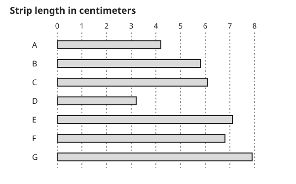
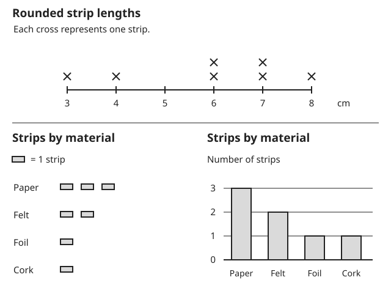

# What can you recover from a graph of strips?

Grade 2 · Measurement plots and category graphs

## Measuring the sample strips

**[2.MD.D.9](https://www.thecorestandards.org/Math/Content/2/MD/D/9/).** Seven sample strips have a length and a material. How long is each strip to the nearest whole centimeter? The drawing generates the observations. Every strip starts at the ruler's zero. One centimeter spans 50 drawing units. Compare the free end with the two nearest whole marks and record the closer one.

| Strip | Material | Endpoint on the drawing | Nearest whole centimeter |
|---|---|---:|---:|
| A | Paper | Just past 4 cm | 4 cm |
| B | Felt | Just before 6 cm | 6 cm |
| C | Paper | Just past 6 cm | 6 cm |
| D | Foil | Just past 3 cm | 3 cm |
| E | Felt | Just past 7 cm | 7 cm |
| F | Paper | Just before 7 cm | 7 cm |
| G | Cork | Just before 8 cm | 8 cm |

For B the end falls just short of 6 and for C just past 6. Both are closer to 6 than to the next mark in the other direction. Keep both observations.

## One cross per measured strip

**[2.MD.D.9](https://www.thecorestandards.org/Math/Content/2/MD/D/9/).** On the line plot, place one cross above the rounded length of each strip. Each step along the baseline is 1 cm. When there is already a cross at a value, put the next one above it.

Read back the stacks from left to right. The lengths are **3, 4, 6, 6, 7, 7, 8 cm**. The empty position for 5 still occupies a full step. The plot preserves the lengths and how often each occurred. The table also preserves which strip gave each observation.

## Two graphs of the materials

**[2.MD.D.10](https://www.thecorestandards.org/Math/Content/2/MD/D/10/).** Classify the very same strips by the material recorded in the source table. In the picture graph the key gives one strip per strip symbol. Count paper (A, C, F), felt (B, E), foil (D) and cork (G). In the bar graph, start every bar at zero and shade one unit of height for each strip. Reading the four tops gives **3, 2, 1, 1 strips**.

| Question about the bars | Read the quantities | Answer |
|---|---|---|
| How many paper and felt strips together? | Join heights 3 and 2. | 3 + 2 = 5 strips. |
| How many strips in all? | Add all four heights. | 3 + 2 + 1 + 1 = 7 strips. |
| If the three paper strips are set aside, how many remain? | Remove 3 from 7. The other bars have heights 2, 1 and 1. | 7 − 3 = 4 strips. |
| How many more paper strips than foil strips? | Match the first unit of the paper bar to the single foil unit. | 3 − 1 = 2 more paper strips. |

**Parent bridge.** Two crosses above 6 cm mean two strips had the same rounded length. Each unit in the paper bar instead records a strip made of paper, whatever its length. Both displays account for all seven strips.
