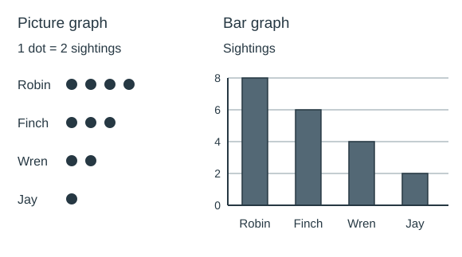

# How many birds does one dot stand for?

Grade 3 · G39 · `data`, `scale` · MP2 · [Goal and source, p. 25](../../goals/grade-3-fractions-and-measurement.md#g39-interpreting-scaled-picture-and-bar-graphs)

## The observation record

During one sample count, each sighting was entered once in order. R means robin, F finch, W wren and J jay. Each letter records one bird sighting.

```text
R F W R J     F R W F R     W R F J R     F R W R F
```

Tally each letter separately. There are **8 robins, 6 finches, 4 wrens and 2 jays**. Their counts sum to 20, the four groups of five entries on the record.

## Reading the two scales



The picture key makes one dot worth two sightings. From top to bottom the rows give 4 × 2 = 8 robins, 3 × 2 = 6 finches, 2 × 2 = 4 wrens and 1 × 2 = 2 jays. Counting the four robin dots as four birds would lose half the robin sightings.

Start at **zero sightings** on the bar graph. Each equal step in height adds two sightings. The robin bar spans four steps, finch three, wren two and jay one. The heights therefore recover the same 8, 6, 4 and 2 as the observation record.

**Parent bridge.** Point to one dot and find two matching letters in the observation record. On the bar graph one vertical interval represents that same pair of sightings.

## Comparing bar heights

How many fewer jay sightings than finch sightings? The finch bar reaches 6 and the jay bar reaches 2. The gap spans two intervals, giving 6 − 2 = **4 fewer jay sightings**. Adding those four to the jay count reaches the finch count.

How many more robin and wren sightings together than finch sightings? Adding the two bars gives 8 + 4 = 12 combined. Subtract the six finch sightings to get 12 − 6 = **6 more sightings**. Grouping heights in steps of two gives another check. Four steps plus two less three leaves three steps, or six sightings.

Standards · 3.MD.B.3
