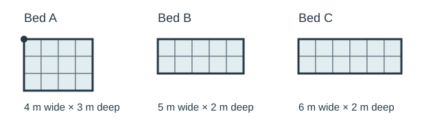

# Can the same fence surround a different area?

Grade 3 · G33 · `perimeter`, `area` · MP3 · [Goal and source, p. 25](../../goals/grade-3-operations-and-area.md#g33-tracing-perimeter-and-comparing-it-with-area)

## One trip around the garden

A gardener fences the edge of a rectangular bed. The **perimeter** is the length of one trip around its closed boundary. On bed A, start at the marked corner. Walk right 4 m, down 3 m, left 4 m and up 3 m to the start. Those four sides use **14 m of fence**.

Suppose the perimeter is 14 m and three successive sides measure 4 m, 3 m and 4 m. Together they use 4 + 3 + 4 = 11 m. The missing length is 14 − 11 = **3 m**. Putting the missing side back gives 11 + 3 = 14 m.

## Equal fences and equal coverings

| Bed | Count the four boundary lengths once (m) | Count the interior tiles by rows (m²) |
|---|---|---|
| A, 3 by 4 | 4 + 3 + 4 + 3 = 14 | 4 + 4 + 4 = 12 |
| B, 2 by 5 | 5 + 2 + 5 + 2 = 14 | 5 + 5 = 10 |
| C, 2 by 6 | 6 + 2 + 6 + 2 = 16 | 6 + 6 = 12 |

A and B use equal fences, yet A needs two extra square meters of covering. A and C need equal coverings, yet C uses two extra meters of fence. Counting columns checks the coverings. Four threes, five twos and six twos give 12, 10 and 12 square meters.

**Parent bridge.** Trace the heavy outside line on bed A for the fence. Touch the middle of every small square in that same bed for the covering. A meter of fence runs along an edge. A square meter of covering sits inside.

Standards · 3.MD.D.8
