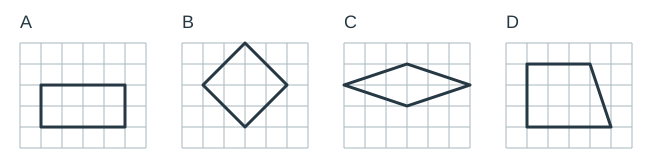

# Which names fit a turned square?

Grade 3 · G34 · `shape` · MP3 · [Goal and source, p. 26](../../goals/grade-3-operations-and-area.md#g34-classifying-quadrilaterals-by-shared-attributes)

## Four closed outlines

Follow each outline back to its starting corner. Each closes after four straight sides, so each is a **quadrilateral**. Use the square grid to compare side lengths and corner turns.

| Outline | What the grid shows | Names that fit |
|---|---|---|
| A | The horizontal sides each span four grid steps. The vertical sides each span two. A square corner fits all four turns. | Quadrilateral and rectangle |
| B | From the top corner to the right corner move two steps right and two down. Turn this side a quarter turn about the center to land on the next side. Four such turns trace the whole outline. Its sides match and its four corners are right angles. | Quadrilateral, rectangle, rhombus and square |
| C | Each slant spans three steps sideways and one vertically. Flipping a side across the middle grid line matches its neighbor, so all four lengths agree. The two sides meeting at the right tip fit inside a square corner with room to spare. | Quadrilateral and rhombus |
| D | The upper edge spans three steps and the lower edge spans four. The left edge runs straight up the grid. The right edge slants, so the top right corner fails the square-corner test. | Quadrilateral only among these names |

A **rectangle** has four right angles. A **rhombus** has four equal sides. A **square** has both. Outline C supplies four equal sides without four right angles. D supplies four straight sides without either narrower set of properties.

**Parent bridge.** Hold a square corner against B, then turn the whole page. The corner still fits and the four lengths still match. That is why “rectangle” and “rhombus” both describe the turned square.

Standards · 3.G.A.1
