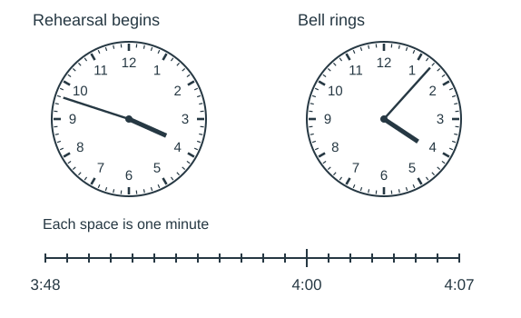

# How many minutes pass before the bell?

Grade 3 · G37 · `time`, `scale` · MP5 · [Goal and source, p. 24](../../goals/grade-3-fractions-and-measurement.md#g37-measuring-elapsed-minutes-across-an-hour)

## Reading both hands

The rehearsal begins in the afternoon. The long hand on the first face has passed 9, the 45-minute mark, by three minute ticks. The short hand is between 3 and 4, close to 4. Write **3:48 p.m.** On the second face the long hand is two ticks past 1, or 5 + 2 = 7 minutes. The short hand is just past 4. Write **4:07 p.m.**

## Crossing four o’clock

How long did rehearsal last? A clock reading locates a **time of day**. The **duration** is the distance between two such positions. A timeline lets us split that distance at a full hour. From 3:48 to 4:00 takes 60 − 48 = **12 minutes**. From 4:00 to 4:07 takes **7 more minutes**. The total is 12 + 7 = **19 minutes**.

**Missing end.** The bell is set to ring 19 minutes after rehearsal begins at 3:48. Move forward 12 minutes to 4:00. There are 19 − 12 = 7 minutes left on the timer, so the bell rings at **4:07 p.m.**

**Missing start.** A recording lasting 19 minutes finishes at 4:07. Move back 7 minutes to 4:00. Move back the other 12 to minute 60 − 12 = 48 of the previous hour. Recording began at **3:48 p.m.** Try a different split. Ten minutes after 3:48 it is 3:58. Two minutes later it is 4:00, and the last seven finish at 4:07.

**Parent bridge.** The minute display goes from 59 back to 00 when sixty minutes complete an hour. Splitting the interval at 4:00 keeps those twelve minutes before the reset in the elapsed count.

Standards · 3.MD.A.1
