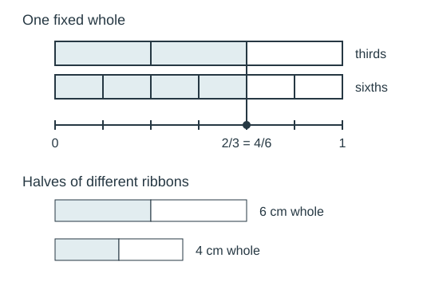

# How can two names mark one point?

Grade 3 · Equivalent fractions and comparisons

## Split each third in two

Use the entire strip from 0 to 1 as the whole. Mark three equal parts and shade the first two. The shading ends at **2/3**. Below it, copy the same strip and add a mark halfway across **every** third. Each old piece becomes two equal pieces. There are now six equal parts and the same shading spans four of them.

Count from zero on the common line. Two third-lengths and four sixth-lengths end at one point, so **2/3 = 4/6**. Each new jump is half as long and there are twice as many. With the same split, the first third alone spans two sixth-lengths, giving **1/3 = 2/6**.

**Parent bridge.** Hold a finger over the point where the shading ends. Adding marks changes the count from two to four and the unit from thirds to sixths. Your finger can stay in place.

## When a fraction lands on a whole number

Starting at zero, locate **3/1** by taking three jumps of one full unit. The landings are 1, 2, 3, so **3/1 = 3**. On the same scale take quarter-length jumps. Four reach the first full unit, giving **4/4 = 1**. Four more complete the second full unit. The eight jumps make two groups of four, so **8/4 = 2**.

## Which way does the sign point?

Both strips in each comparison have the same length as the 0-to-1 whole.

| Pair | Count or compare the parts | Result |
|---|---|---|
| Three eighths and five eighths | Each has the same size of part. Five copies reach two eighth-lengths farther than three copies. | 3/8 < 5/8 |
| Two thirds and two fourths | A whole divided among three gives a larger share than the same whole divided among four. Taking two of each preserves that order. | 2/3 > 2/4 |
| Two thirds and four sixths | Each of the two third-lengths contains exactly two sixth-lengths. The endpoints coincide. | 2/3 = 4/6 |

What if the wholes differ? The bottom drawing shows a 6 cm ribbon and a 4 cm ribbon. The shaded half of the first is 3 cm because 3 + 3 = 6. The shaded half of the second is 2 cm because 2 + 2 = 4. The longer shaded piece can make its fraction look larger. Each ribbon still has exactly half its own length shaded. Compare lengths in centimeters or use the same whole to compare fraction sizes.

Standards · [3.NF.A.3](https://www.thecorestandards.org/Math/Content/3/NF/A/3/), [3.NF.A.3.a](https://www.thecorestandards.org/Math/Content/3/NF/A/3/a/), [3.NF.A.3.b](https://www.thecorestandards.org/Math/Content/3/NF/A/3/b/), [3.NF.A.3.c](https://www.thecorestandards.org/Math/Content/3/NF/A/3/c/), [3.NF.A.3.d](https://www.thecorestandards.org/Math/Content/3/NF/A/3/d/)
