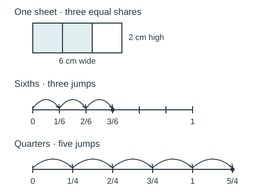

# How far is one share on a line?

Grade 3 · G35 · `share`, `area`, `fraction`, `scale` · MP6 · [Goal and source, pp. 24, 26](../../goals/grade-3-fractions-and-measurement.md#g35-unit-fractions-in-regions-and-on-a-number-line)

## One whole sheet

The whole is a sheet 6 cm wide and 2 cm high. Measure 2 cm and 4 cm along the top edge. At each mark, cut straight down to the bottom edge. The three pieces are matching 2-by-2 cm squares. Each covers 4 cm². Reassembling them edge to edge gives 4 + 4 + 4 = 12 cm², the full 6 × 2 area.

One piece covers **one third**, written **1/3**, of the sheet. One third is the size of a single share. Take the first two pieces together. They cover 8 cm², or **2/3** of the sheet. The bottom number, the **denominator**, says how many equal parts make one whole. The top number, the **numerator**, counts how many of those parts we take.

## Six spaces between seven marks

On the middle line the distance from 0 to 1 is one whole unit. Divide that distance into six equal intervals. Counting both ends gives **seven marks**. The first jump from 0 ends at **1/6**. The next two equal jumps end at 2/6 and **3/6**. The third endpoint is a number halfway between 0 and 1 because three jumps have been taken and three of the same length remain.

## A fifth quarter jump

Keep the same distance from 0 to 1 on the bottom line. Divide it into four equal intervals. Starting at zero, the successive landings are 1/4, 2/4, 3/4, 4/4 and **5/4**. The fourth jump reaches one whole. The fifth ends one quarter beyond it. Cover the last label. The distance from zero is still one full unit and one of its four equal parts, enough to recover 5/4.

**Parent bridge.** On the paper each third is one repeatable share of area. On a line each sixth or quarter is one repeatable jump of length. The fraction at a landing tells how far the jumps have carried us from zero.

Standards · 3.NF.A.1, 3.NF.A.2, 3.NF.A.2.a, 3.NF.A.2.b, 3.G.A.2
