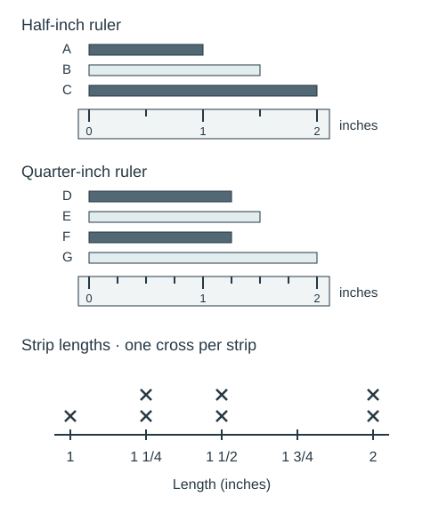

# Which ruler marks hold two strips?

Grade 3 · Quarter-inch measurements and line plots

## Read from the origin

These seven sample paper strips are drawn to the scales beside them. Read inches from the ruler marks. The left edge of every strip meets the ruler's **zero**, slightly inside the drawn body. The first ruler marks halves, with two equal intervals per inch. The second marks quarters, with four per inch. Resizing the picture keeps each strip lined up with its own scale.

| Strip | Ruler used | Intervals from zero to far end | Length observed |
|---|---|---:|---|
| A | half-inch | 2 halves | 1 inch |
| B | half-inch | 3 halves | 1 1/2 inches |
| C | half-inch | 4 halves | 2 inches |
| D | quarter-inch | 5 quarters | 1 1/4 inches |
| E | quarter-inch | 6 quarters | 1 1/2 inches |
| F | quarter-inch | 5 quarters | 1 1/4 inches |
| G | quarter-inch | 8 quarters | 2 inches |

For example, D extends one whole inch and one more quarter. B and E end at the same length because three halves cover the same distance as six quarters.

## Rebuild the list from the plot

Use a quarter-inch spacing to keep every measured length at its own position. Place one cross per strip. A second strip of the same length gets a cross directly above the first.

Read the plot from left to right with the table covered. One cross gives one 1-inch strip. Two crosses give two at 1 1/4 inches. Two more give two at 1 1/2 inches. The 1 3/4-inch tick is empty. Two crosses at 2 inches finish the list. The frequencies 1 + 2 + 2 + 0 + 2 = 7 account for every observation.

**Parent bridge.** Move sideways one tick to change length by a quarter inch. Move up the stack at 1 1/4 to count the second strip at exactly that same length.

Standards · [3.MD.B.4](https://www.thecorestandards.org/Math/Content/3/MD/B/4/)
