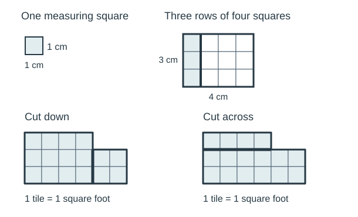

# How many squares cover the floor?

Grade 3 · G32 · `area`, `length`, `units`, `product`, `add`, `groups`, `laws`, `compose` · MP7 · [Goal and source, p. 25](../../goals/grade-3-operations-and-area.md#g32-measuring-with-square-units-and-adding-rectangle-areas)

## A square to measure a surface

A flat paper rectangle has a **boundary**, the line around its outside, and a **region** whose surface we can cover. Its **area** tells how much surface it covers. Choose a square measuring 1 centimeter along each of its four edges. Its area is **1 square centimeter** (1 cm²). Read lengths from the labeled units on these plans.

Place four such squares edge to edge along the top of the paper. Fit two more identical rows underneath. The outer edges reach every paper edge. Neighboring squares meet along lines and each interior belongs to just one square. Counting the interiors by rows gives 4 + 4 + 4 = **12 cm²**. The outline itself takes no tiles.

## What changes with the tile?

Count complete rows of identical square tiles in each exact covering. The objects in these examples have different sizes.

| Surface | Square chosen | Count by rows | Area covered |
|---|---|---|---|
| Paper shown above | side 1 centimeter | 4 + 4 + 4 | 12 square centimeters |
| Patio | side 1 meter | 3 + 3 | 6 square meters |
| Card | side 1 inch | 2 + 2 + 2 | 6 square inches |
| Hearth | side 1 foot | 3 + 3 + 3 | 9 square feet |
| Tray | one square paper stamp | 5 + 5 | 10 stamp squares |

An improvised unit works when every stamp is the same size and the copies exactly cover the tray.

## A product you can cover

The paper's height of 3 cm gives three rows. Its width of 4 cm gives four squares in each row. Multiplying the side lengths gives 3 cm × 4 cm = **12 cm²**, matching the count. Reading down columns gives 3 + 3 + 3 + 3 = 12. For a patio 2 m deep and 3 m wide, the side lengths likewise give 2 × 3 = 6 square meters.

To start from the product, draw **3 × 4** as three rows of four unit squares. Split its width after the first column, as in the drawing. Each row then contains 1 + 3 squares. The two rectangles cover the original rectangle exactly, so 3 × (1 + 3) = (3 × 1) + (3 × 3) = 3 + 9 = **12 square units**.

## Two cuts of a stepped floor

Each tile in the floor plan is 1 foot on a side. Start with a room 4 feet wide and 3 feet deep. Join a 2-by-2-foot alcove on the right, aligned at the bottom. The two pieces meet along the lower two feet of the room's right edge. That seam is a line with no area.

- **Cut straight down.** Three rows of four in the room plus two rows of two in the alcove give (3 × 4) + (2 × 2) = 12 + 4 = **16 square feet**.
- **Cut straight across.** Separate the top row of four from the two full rows of six underneath. (1 × 4) + (2 × 6) = 4 + 12 = **16 square feet**.

From the top left, the clockwise walk goes right 4, down 1, right 2, down 2, left 6, up 3 feet. The two tiles that would fill the upper-right notch lie outside the floor. Counting across the floor gives 4 + 6 + 6 = 16. The vertical seam runs two feet inside and the horizontal seam runs four feet inside in the other drawing. Neither adds a strip of tiles.

**Parent bridge.** Point to the complete rows for each term. In the first cut the 4 in 12 + 4 counts a two-row alcove. In the second cut the 4 in 4 + 12 counts the single top row. The pieces change while the floor stays covered.

Standards · 3.MD.C.5, 3.MD.C.5.a, 3.MD.C.5.b, 3.MD.C.6, 3.MD.C.7, 3.MD.C.7.a, 3.MD.C.7.b, 3.MD.C.7.c, 3.MD.C.7.d
