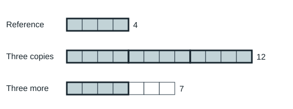

# Copies, factors and repeating changes

Grade 4 · Multiplicative comparisons, factor pairs and patterns

## Which amount is the reference?

[4.OA.A.1](https://www.thecorestandards.org/Math/Content/4/OA/A/1/), [4.OA.A.2](https://www.thecorestandards.org/Math/Content/4/OA/A/2/)

Inez has four beads. “Sol has three times as many as Inez” gives three copies of her four, or **12 beads**. “Sol has three more than Inez” gives four plus three single beads, or **7 beads**.

Read the bars in bead units. From the common origin the first ends at 4, the second at 12 and the third at 7. The extra length in the second is 12 − 4 = 8 beads. The additive difference in the third is 7 − 4 = 3 beads.

| What is unknown? | Equation and solution | Read back into the story |
|---|---|---|
| Compared count C | C = 3 × 4 = 12 | Sol's 12 beads fill three lengths of four. |
| Reference count R if Sol has 12, three times Inez's count | 3 × R = 12. R = 12 ÷ 3 = 4 beads. | Split 12 into three equal lengths. Inez's four fit each length. |
| Factor F if Inez has 4 and Sol has 12 | F × 4 = 12. F = 12 ÷ 4 = 3. | Count groups ending at 4, 8 and 12. Sol has three times as many beads as Inez. |

Read the same three-copy bar with a different label covered each time. Cover its end label to find C, one segment length to find R, or the number of segments to find F.

Starting with the equation 12 = 3 × 4, choose four beads as the reference. Say “Twelve beads is three times as many as four beads.” Translating those words back gives three groups of four.

**Parent bridge.** Cover the first four beads in both longer bars. One bar has two whole reference lengths left. The other has three individual beads left.

## When is the pair list finished?

[4.OA.B.4](https://www.thecorestandards.org/Math/Content/4/OA/B/4/)

For a target from 1 through 100, try the smaller side of a rectangular array in order. An exact division makes a factor pair. Stop when the candidate times itself exceeds the target: even the smallest untested pair with both sides that large would overshoot.

| Target | All pairs, checked by multiplication | Rejected smaller sides (remainder) | First square above target | Classification |
|---:|---|---|---|---|
| 1 | 1 × 1 = 1 | none | 2 × 2 | One distinct factor. Neither prime nor composite. |
| 17 | 1 × 17 = 17 | 2 (1), 3 (2), 4 (1) | 5 × 5 | Prime, exactly two positive factors. |
| 36 | 1 × 36, 2 × 18, 3 × 12, 4 × 9, 6 × 6 all give 36 | 5 (1) | 7 × 7 | Composite, more than two positive factors. |
| 100 | 1 × 100, 2 × 50, 4 × 25, 5 × 20, 10 × 10 all give 100 | 3 (1), 6 (4), 7 (2), 8 (4), 9 (1) | 11 × 11 | Composite. |

Each partner divides its target exactly, so the target is a **multiple** of either partner. For example, 36 is a multiple of 9 because 9 × 4 = 36. It falls between 5 × 7 = 35 and 5 × 8 = 40, so it is not a multiple of 5. No positive target is a multiple of 0: a whole-number count of zeros always totals zero. Conversely, 0 itself is a multiple of 9 because 9 × 0 = 0.

**Parent bridge.** Turn a 4-by-9 array to see 9 by 4. It is the same unordered pair. Turning the 6-by-6 array even leaves the dimensions in the same order.

## What keeps alternating?

[4.OA.C.5](https://www.thecorestandards.org/Math/Content/4/OA/C/5/)

Start at 1 and add 3 each time. The terms are **1, 4, 7, 10, 13, 16**. Rebuild one step: 10 + 3 = 13. A feature absent from the instruction is that odd and even terms alternate.

Arrange each term in pairs. Adding three supplies a pair and one extra counter. If all old counters were paired, that extra leaves one unpaired. If one was unpaired, the extra completes its pair. The same reasoning applies after any term, including the fresh terms 16 + 3 = 19 and 19 + 3 = 22.

A shape strip has a related rule: start with one square and append a block of three squares at each step. Its lengths are 1, 4, 7 and 10 squares. Pair adjacent squares from the left. A lone end square occurs on every other strip, for the same pairing reason.

**Parent bridge.** Slide the extra counter next to the previous unpaired counter when there is one. Whether there is a partner explains the next term's parity.
