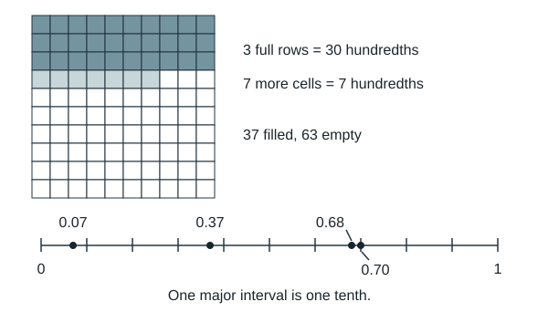

# Where do 37 hundredths land?

Grade 4 · Tenths, hundredths and decimal comparisons

## A grid and a unit interval

[4.NF.C.5](https://www.thecorestandards.org/Math/Content/4/NF/C/5/), [4.NF.C.6](https://www.thecorestandards.org/Math/Content/4/NF/C/6/), [4.NF.C.7](https://www.thecorestandards.org/Math/Content/4/NF/C/7/)

One complete grid represents one whole. It has ten equal rows, each with ten equal cells. Cover three rows: 3/10 = 30/100 = 0.30. Seven more cells cover 7/100 = 0.07. Together **3/10 + 7/100 = 30/100 + 7/100 = 37/100 = 0.37**. The addition counts equal-sized hundredths after the renaming.

### Read the point

Count the unused cells to check: three remain in the fourth row and six whole rows are empty. That is 63 unfilled, leaving 100 − 63 = 37 filled. The number line uses the same whole from 0 to 1. Ten hundredth-steps reach the first tenth, and 37 such steps reach the marked point between 0.3 and 0.4.

### Compare the places

Seven complete rows would be **0.7 = 0.70**: 7 tenths and 70 hundredths end at the same point. **0.07 < 0.7** because the empty tenths place in 0.07 leaves just seven hundredths. **0.7 > 0.68** because 70 hundredths is two steps farther than 68 hundredths. Reading the digit strings “7” and “68” as whole numbers would reverse that comparison. Different-sized grids would need a common reference whole before comparing the physical amounts.

**Parent bridge.** A trailing zero in 0.70 keeps the seven in tenths. Moving the seven one place to the right in 0.07 changes seven rows to seven individual cells.
