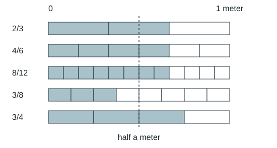
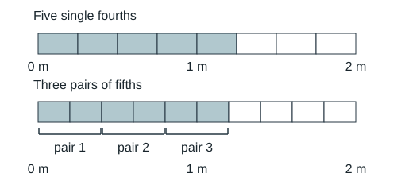

# How much of the same meter?

Grade 4 · Equivalent fractions and fraction arithmetic

## Subdivide and compare

[4.NF.A.1](https://www.thecorestandards.org/Math/Content/4/NF/A/1/), [4.NF.A.2](https://www.thecorestandards.org/Math/Content/4/NF/A/2/)

The fractional units used in this grade have denominators 2, 3, 4, 5, 6, 8, 10, 12 or 100. Each strip below is **one meter**, drawn from the same left edge to the same right edge. Read a fraction by counting shaded parts and then all equal parts in its strip.

The first pair already has the same shaded length. Split **each** third in two, including the unshaded third. Two shaded parts become four, and three total parts become six. Thus **2/3 = 4/6**. Generate another name by splitting every sixth in two: **4/6 = 8/12**. Removing the added cuts recovers the original shaded interval. In general, if each old part becomes the same positive whole-number count of smaller parts, both counts multiply by that count and the endpoints stay fixed.

### Two ways to compare

For **3/8 < 2/3**, use half a meter as a benchmark. Three eighths falls short of 4/8 = 1/2. Two thirds reaches 4/6, past 3/6 = 1/2. Check directly on the drawing without renaming either fraction: from the common left edge the 3/8 length stops well before the 2/3 length.

For another comparison, **3/4 > 2/3**. In twelfths, three quarters cover 9/12 and two thirds cover 8/12. The last strip ends one twelfth of a meter farther. Each comparison uses the same one-meter whole. [Earlier equivalent locations](../grade-3/names-for-one-point.md)

**Parent bridge.** Point to one original third and the two sixths inside it. Every shaded third gains the same extra boundary as every unshaded third.

## Join, separate and exchange

[4.NF.B.3](https://www.thecorestandards.org/Math/Content/4/NF/B/3/), [4.NF.B.3.a](https://www.thecorestandards.org/Math/Content/4/NF/B/3/a/), [4.NF.B.3.b](https://www.thecorestandards.org/Math/Content/4/NF/B/3/b/), [4.NF.B.3.c](https://www.thecorestandards.org/Math/Content/4/NF/B/3/c/), [4.NF.B.3.d](https://www.thecorestandards.org/Math/Content/4/NF/B/3/d/)

Keep one meter as the whole. Each fourth-meter piece has the same length, even as the pieces extend beyond one meter. Lay five end to end: 1/4 + 1/4 + 1/4 + 1/4 + 1/4 = **5/4 meter**, or 1 1/4 meters. Four pieces fill a meter and one remains.

### Two cuts in five eighths

Take five eighth-meter pieces in a row. Split after the first: **5/8 = 1/8 + 4/8**. Slide the split one piece to the right: **5/8 = 2/8 + 3/8**. Reading in eighths, both 1 + 4 and 2 + 3 count five pieces.

### Lengths joined and cut

**Joining lengths.** Place a 3/8-meter marker strip end to end with a 2/8-meter strip, with no overlap. How far do they reach? 3/8 + 2/8 = **5/8 meter**. Check by removing the last two eighths to recover three eighths. If the lengths are 1 3/4 meters and 1 2/4 meters, the wholes give 2 meters and the fourths give 5/4 meter. Together that is **3 1/4 meters**. Count fourths instead: 7 + 6 = 13 fourths.

**Cutting a length.** Cut 1 3/4 meters from a 2 1/4-meter tape. What remains? Exchange one whole meter for four fourths. The starting length becomes 1 whole and 5 fourths. The trade preserves all nine fourths: 2 × 4 + 1 = 1 × 4 + 5. Subtract by place: **2 1/4 − 1 3/4 = (1 + 5/4) − (1 + 3/4) = 2/4 meter**, or 1/2 meter. Removing one whole and three fourths leaves two fourth-meter pieces. Check by putting it back: 1 3/4 + 2/4 = 1 whole + 5/4 = 2 1/4 meters.

**Parent bridge.** A whole meter opens into four fourth-meters just as a ten opens into ten ones. The number of pieces changes because the counting unit changes.

## Count copies of a measured length

[4.NF.B.4](https://www.thecorestandards.org/Math/Content/4/NF/B/4/), [4.NF.B.4.a](https://www.thecorestandards.org/Math/Content/4/NF/B/4/a/), [4.NF.B.4.b](https://www.thecorestandards.org/Math/Content/4/NF/B/4/b/), [4.NF.B.4.c](https://www.thecorestandards.org/Math/Content/4/NF/B/4/c/)

Five copies of one quarter-meter give **5 × (1/4) = 5/4** meters. In the upper strip each small interval is one fourth of a meter. Four intervals reach the first whole-meter boundary, and the fifth lies beyond it.

### Cord for three people

Three people each need 2/5 meter of cord. How much cord is needed altogether? Each person's pair of fifths is one group. Across three people the repeated sum is 2/5 + 2/5 + 2/5 = **3 × (2/5) = 6/5 meters**. Count the pieces in a different order: the first whole contains five fifths and one more piece follows. The total is 1 1/5 meters, more than 1 meter and less than 2 meters. The five-fourths example also lies strictly between 1 and 2 meters.

**Parent bridge.** Bracket one person's two fifths first. Three counts the people, and 2/5 meter measures the cord for one person.
