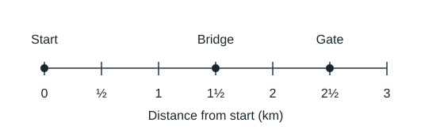
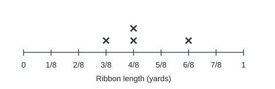

# One quantity, different counts

Grade 4 · Measurement conversions and fractional line plots

## Read across a conversion table

[4.MD.A.1](https://www.thecorestandards.org/Math/Content/4/MD/A/1/)

How many smaller units describe the original quantity in the left column? The first row gives the conversion factor. Two copies of that row give the second row. Double the second row and add one first row to get the five-unit row.

**Length in kilometers and meters.** Each kilometer contains 1,000 meters.

| Kilometers | Meters |
|---:|---:|
| 1 | 1,000 |
| 2 | 2,000 |
| 5 | 5,000 |

**Length in meters and centimeters.** Each meter contains 100 centimeters.

| Meters | Centimeters |
|---:|---:|
| 1 | 100 |
| 2 | 200 |
| 5 | 500 |

**Mass in kilograms and grams.** Each kilogram contains 1,000 grams.

| Kilograms | Grams |
|---:|---:|
| 1 | 1,000 |
| 2 | 2,000 |
| 5 | 5,000 |

**Weight in pounds and ounces.** Each pound contains 16 ounces.

| Pounds | Ounces |
|---:|---:|
| 1 | 16 |
| 2 | 32 |
| 5 | 80 |

**Liquid volume in liters and milliliters.** Each liter contains 1,000 milliliters.

| Liters | Milliliters |
|---:|---:|
| 1 | 1,000 |
| 2 | 2,000 |
| 5 | 5,000 |

**Time in hours and minutes.** Each hour contains 60 minutes.

| Hours | Minutes |
|---:|---:|
| 1 | 60 |
| 2 | 120 |
| 5 | 300 |

**Time in minutes and seconds.** Each minute contains 60 seconds.

| Minutes | Seconds |
|---:|---:|
| 1 | 60 |
| 2 | 120 |
| 5 | 300 |

**Length in feet and inches.** Each foot contains 12 inches.

| Feet | Inches |
|---:|---:|
| 1 | 12 |
| 2 | 24 |
| 5 | 60 |

Check all eight tables from their one-unit rows. For the three factors of 1,000, two copies give 2,000 and five give 5,000. For centimeters the counts are 200 and 500. For ounces, 16 + 16 = 32 and 32 + 32 + 16 = 80. Each time table gives 120 and 300. For inches, 12 + 12 = 24 and 24 + 24 + 12 = 60. Chaining within an attribute, 1 km = 1,000 m = 100,000 cm and 1 hour = 60 minutes = 3,600 seconds.

**Parent bridge.** Lay twelve inch intervals along one foot. Measuring that same span in inches gives a larger number because more of the smaller units fit.

## What does the answer measure?

[4.MD.A.2](https://www.thecorestandards.org/Math/Content/4/MD/A/2/)

**Distance.** Walk 1 1/2 km to a bridge, then 1 km to a gate. How far is the entire trip in meters? The distance line uses equal half-kilometer intervals.

The first leg spans three intervals and the second spans two. Read the scale independently: five half-kilometers make 2 1/2 km. Convert the legs separately: 1,500 m + 1,000 m = **2,500 m**. The diagram places the start, bridge and gate at horizontal coordinates 56, 272 and 416. A half-kilometer spans 72 drawing units. The measured spans of 216 and 144 recover both legs.

**Time.** A rehearsal lasts one hour. After 18 minutes of warmup, how many minutes remain? 1 hour = 60 minutes. Subtract the elapsed interval: 60 − 18 = **42 minutes**. Joining 18 and 42 minutes fills exactly one hour.

**Liquid volume.** Four bottles each hold 3/4 L. What volume do they hold together? Four copies of three quarter-liters give 12 quarter-liters, or **3 L**. Check by pouring the total equally back into four bottles: each receives three of the twelve equal quarters.

**Mass.** A 2 kg sack of rice is divided equally into eight bags. How many grams per bag? 2 kg = 2,000 g. Divide 2,000 g by 8 bags to get **250 g per bag**. Recombine: four bags weigh 1,000 g and eight weigh 2,000 g.

**Money.** A ticket costs $0.70 and a map costs $0.68. How much for both? Convert to cents so the units match. 70 + 68 = 138 cents = **$1.38**. Paying $1.38 and taking away the 70-cent ticket leaves 68 cents for the map.

**Parent bridge.** The five intervals from start to gate can each be named half a kilometer or 500 meters. Changing the unit keeps both endpoints fixed.

## Which marks belong to which ribbons?

[4.MD.B.4](https://www.thecorestandards.org/Math/Content/4/MD/B/4/)

Four ribbon lengths, measured in yards, are **3/8, 1/2, 1/2, 3/4**. Each cross on the line plot stands for one ribbon. The scale increases by one eighth of a yard at every tick.

Read the marks from the drawing: 3/8 once, 4/8 twice and 6/8 once. This reconstructs all four measurements because 4/8 = 1/2 and 6/8 = 3/4.

What is the combined length of the two ribbons at the tallest stack? The two marks supply two observations: 4/8 + 4/8 = 8/8 = **1 yard**. How much longer is the longest ribbon than the shortest? Read the extreme occupied ticks. The difference is 6/8 − 3/8 = **3/8 yard**. Count the three intervals from 3/8 to 6/8 as a check.

**Parent bridge.** Move sideways to read a length. Move up at the half-yard tick to count another ribbon with that same measurement. [Earlier measurement plot](../grade-3/strip-lengths.md)
