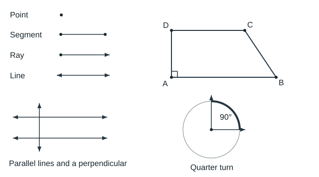
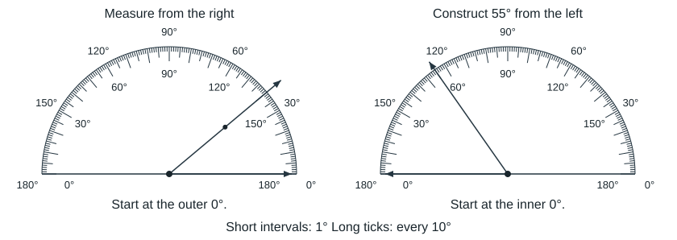
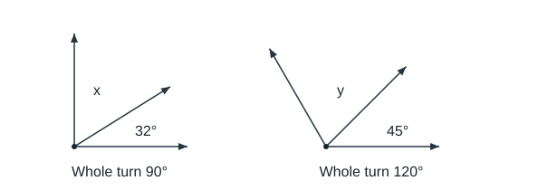

# Where does the turn begin?

## G58 · Lines, endpoints and turns

[G58 · goal and source](../../goals/grade-4-geometry.md#g58-drawing-lines-and-measuring-turns) · 4.G.A.1, 4.MD.C.5, 4.MD.C.5.a, 4.MD.C.5.b, 4.MD.C.6 · `shape`, `angle`, `fraction`, `scale` · MP5

A **point** marks a position. A **segment** includes both endpoints and stops there. A **ray** starts at one endpoint and extends in one direction. A **line** extends in both directions. Dots locate endpoints or named positions. Arrowheads show continuation.

In the trapezoid, the four vertices are points and the edges are segments. Imagine extending AB and DC in both directions: those lines stay parallel. AD meets both at right angles. At B the two rays starting at B through A and C make an acute interior angle. At C the rays toward B and D make an obtuse interior angle. At A the angle between AB and AD is right. A right angle measures 90°, an acute angle measures more than 0° and less than 90°, and an obtuse angle measures more than 90° and less than 180°.

### Degrees on a circle

An **angle** is formed by two rays with a common endpoint, the vertex. Measure the chosen turn by the arc it cuts off on a circle centered there. A full turn is 360°. One of 360 equal intervals is **one degree**, or 1/360 of a full turn. In the circle the radii enclose one of four equal quarter turns. The marked quarter-circle arc therefore spans 360 ÷ 4 = **90°**. Counting 40 adjacent one-degree intervals gives 40°, regardless of circle radius or ray length.

### Read and construct on a protractor

**Measure from the right.** Place the center mark on the vertex and the horizontal zero line along the ray pointing right. Use the outer labels, starting at 0° on the right. Each short interval is one degree. The other ray reaches the fourth long ten-degree tick, so the angle is **40°**. The other scale reads 140° at the same mark. That is the obtuse angle made by the sloping ray and the leftward baseline. The rightward baseline selects the acute turn instead.

**Construct from either baseline.** For a 40° sketch, draw the rightward baseline, center the tool on its endpoint, mark the fourth ten-degree tick from the right and draw the ray through it. For a **55°** sketch, start with a leftward baseline. This time follow the inner labels from 0° at the left. Count five ten-degree spans and five more one-degree intervals, mark the point and draw the second ray from the center. From the right its direction reads 125°, a check since 180 − 125 = 55.

Check a sketch from the other ray: turn the protractor until its zero line follows the sloping ray, with the scale on the side containing the selected turn. The horizontal ray is 40 or 55 one-degree intervals away, respectively. In the first drawing a dot halfway along the sloping ray and its arrow tip line up with the same center and tick. Shortening the drawn arm to that dot leaves the turn at 40°.

**Parent bridge.** Touch the center, follow the starting ray to its zero, then follow that scale to the second ray. The two printed scales allow either side to be the starting side.

## G59 · Which degree intervals belong to each part?

[G59 · goal and source](../../goals/grade-4-geometry.md#g59-finding-an-unknown-angle-from-adjacent-turns) · 4.MD.C.7 · `angle`, `add`, `equal` · MP3

In the left drawing let x be the remaining part of the right angle. The parts share a vertex and their interiors do not overlap. **32° + x = 90°**, so x = 90° − 32° = **58°**. Check by rebuilding the quarter turn: 32° + 58° = 90°.

In the right drawing the whole turn is 120° from the rightward ray. The first part spans 45°. The remaining part y satisfies 45° + y = 120°, so **y = 75°**. Measuring the two sloping rays from the same baseline checks the difference, 120° − 45°.

**Applied turn.** A camera pans 25° from its starting direction, then another 40° in the same direction. Let t be the total pan. The first pan ends where the second begins. t = 25° + 40° = **65°**. Reversing 40° from the end returns to 25°.

On that same pan, the region from 0° to 40° and the region from 25° to 65° each measure 40°. Adding them would give 80°. The interval from 25° to 40° is included twice. Removing its 15° gives the actual span of 65°.

**Parent bridge.** Trace from the starting ray through the shared edge to the ending ray. Each one-degree interval gets counted once when the interiors of the parts are separate.
