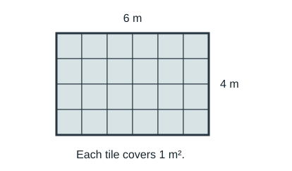

# How much garden, and how much edging?

Grade 4 · Rectangle area and perimeter

## Recover a side from a measure

[4.MD.A.3](https://www.thecorestandards.org/Math/Content/4/MD/A/3/)

For a rectangle, **A = length × width** counts square units inside. **P = 2 × (length + width)** counts linear units around the outside. A rectangle 5 cm by 3 cm has A = 5 × 3 = **15 cm²** and P = 2 × (5 + 3) = **16 cm**. Check by counting three rows of five unit squares and walking the four sides: 5 + 3 + 5 + 3 = 16 cm.

A rectangular garden covers 24 m². Its length is 6 m. How wide is it, and how much edging surrounds it? Each one-meter-wide row along its length covers six square meters. There must be 24 ÷ 6 = **4 rows**, so the width is **4 m**. The edging measures 2 × (6 + 4) = **20 m**.

Independently count 6 + 6 + 6 + 6 = 24 tile interiors. Trace the outside, including the far sides: 6 + 4 + 6 + 4 = 20 one-meter edges. The lines between tiles stay inside the garden.

Reverse the question. A different rectangle has perimeter 22 m and length 7 m. Remove the two long sides: 22 − 2 × 7 = 8 m. Two equal widths share that 8 m, so each is **4 m**. Check by tracing 7 + 4 + 7 + 4 = 22 m.

**Parent bridge.** Dividing 24 square meters into six-square-meter rows tells how many rows fit. Each row adds one meter to the width. [Earlier tiled floor](../grade-3/tiles-and-floor.md)
