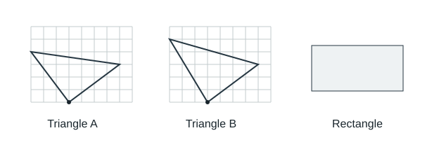
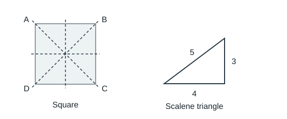

# Which properties survive a turn or a fold?

## G60 · Sort by the actual corners

[G60 · goal and source](../../goals/grade-4-geometry.md#g60-classifying-figures-by-lines-and-angle-sizes) · 4.G.A.2 · `shape`, `angle` · MP3

From the bottom vertex of triangle A, one side goes four steps right and three up. A quarter turn left takes that move to **three left and four up**, exactly the other side. Thus the two sides are perpendicular and A is a **right triangle**. The two remaining angles are acute. No pair of sides is parallel because each pair meets at a vertex.

In triangle B one side still goes four right and three up. The other goes **three left and five up**. The right-angle direction would reach three left and four up. Raising that endpoint brings the side closer to the upward direction and inside the quarter turn. The bottom angle is acute. At the left vertex both outgoing sides run right and down. At the right vertex both run left, one gently up and one down. Their directions also fit inside a quarter turn: from a left-four, down-three move the perpendicular pointing upper left goes left three, up four, steeper than the left-seven, up-two edge. Thus B has three acute angles, no perpendicular sides and no parallel sides.

The rectangle has two pairs of parallel opposite sides and four perpendicular neighbor pairs. Its four angles are all right. A sort for “has a right angle” therefore includes **A and the rectangle**. A sort for “has parallel sides” includes **the rectangle alone**. None of the three has an obtuse angle.

Turn the paper a quarter turn. A's two moves now point three left and four up, and four left and three down. A quarter turn still carries the first to the second. In B the extra grid step turns with the paper. The near miss and the rectangle's two parallel pairs persist.

**Parent bridge.** Fit a square corner at A's bottom vertex, then turn the figure and the corner together. Their match survives even when neither edge lies along the page. [Earlier turned figures](../grade-3/four-sided-figures.md)

## G61 · Test an entire boundary

[G61 · goal and source](../../goals/grade-4-geometry.md#g61-testing-reflection-symmetry) · 4.G.A.3 · `symmetry`, `shape` · MP3

A reflection fixes the points on its axis. Each other point travels straight across, perpendicular to the axis, to the same distance on the other side. A symmetry axis maps the **entire figure** onto itself.

Start with the [accepted 4-by-2 rectangle and its diagonal test](../rectangle-reflection.md#test-the-folds). Across the horizontal midline the top and bottom corners are each 1 unit from the fold. Across the vertical midline the left and right corners are each 2 units from it. Each edge lands on the segment joining its reflected endpoints, so both midlines work. The equal-area halves along diagonal AC each contain 4 square units. Yet reflecting B across AC lands outside the rectangle. To check the picture, use its drawing coordinates: B is (322, 80), the perpendicular foot is (274, 176), and the reflected point is (226, 272), below the bottom at 200. Each half of that trip moves 48 left and 96 down. A diagonal step of two right and one down turns a quarter turn to one left and two down. Equal areas alone do not make the boundaries coincide. The two long edges must map to long edges. Their midpoints must either stay fixed or swap, leaving just the two midlines as possible axes.

For the square, name the corners A, B, C, D clockwise from top left. It measures 4 units per side. Across the vertical midline A swaps with B and D with C, each traveling 2 units to the line and 2 beyond. Across the horizontal midline A swaps with D and B with C at the same distances. Across AC, A and C stay fixed and B swaps with D. BD crosses AC at the center at a right angle, and the center halves BD. Across BD the same reasoning swaps A with C and fixes B and D. Each of the four folds matches every edge and encloses the same interior. To exhaust the possibilities, an axis must pass through the center and send A to a corner. Fixing A gives AC. Sending A to B, C or D gives the perpendicular bisector of the corresponding segment, already counted. The square has **four axes**.

In the triangle, the legs span 3 and 4 units. Measure the sloping side as 5 units on the same scale (its drawing displacement is 120 across and 90 up, a length of 150 at 30 per unit). All three lengths differ, making it **scalene**. A reflection would have to take each side to the unique side of the same length. Every vertex, where two particular sides meet, would then stay fixed. Three noncollinear vertices cannot all lie on one axis. The triangle has **no reflection axis**.

**Parent bridge.** The rectangle diagonal divides the inside evenly. Follow just the off-axis corner through a fold and see where its two edges land. A true fold matches the outline as well as the area.
