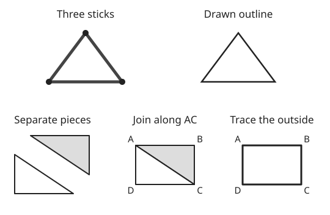

# Three sticks and two paper triangles

Kindergarten · Construction and composition

## Build a roof outline and draw it

**[K.G.B.5](https://www.thecorestandards.org/Math/Content/K/G/B/5/).** The front of a roof has two sloping edges above a straight bottom edge. How can three sticks model that triangular outline?

Lay the longest stick across the bottom. Put the end of one shorter stick at each end of the bottom stick. Bring their free ends together above the middle and join the three touching pairs of ends with clay. Trace from the left joint up to the roof peak, down to the right joint, then along the bottom to the starting point. The path closes.

To draw the model, mark a dot for each of those three joints on paper. Connect left to peak, peak to right and right to left with straight lines. Each line stands for one stick, and each corner stands for one joint. The upper drawings show the same outline at the same size.

## Fit the paper pieces together

**[K.G.B.6](https://www.thecorestandards.org/Math/Content/K/G/B/6/).** Cut a rectangular card from its upper-left corner A to its lower-right corner C. B is the upper-right corner and D the lower-left. There are now two triangles, ABC and ACD. Can these two pieces make the original rectangle again?

Place ABC with its square corner B at upper right. Bring ACD up to it, keeping its square corner D at lower left. Match the **entire sloping side AC** of one piece to AC of the other, A to A and C to C. The pieces lie on opposite sides of that line. Their edges meet along the seam. No gap remains, and each piece covers its own side of the card.

Trace the outside from **A to B to C to D to A**. Across, down, back and up gives four straight sides and four square corners. The trace closes at A. The whole is a **rectangle**.

**Check by taking it apart.** Slide the lower-left piece away. An open strip appears between the two sloping sides. Slide it back until both endpoints match and the strip disappears. At every height between the top and bottom, the lower-left piece reaches from the left side to the seam and the upper-right piece reaches from the seam to the right side. Together they cover the entire card once.

**Parent bridge.** Before joining, a finger can follow the sloping side of either triangle with paper on just one side. After joining, paper lies on both sides of that seam. A finger tracing around the outside follows four sides and never turns onto the diagonal.
