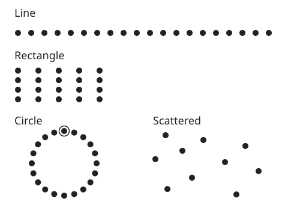

# Counting on the number path and on the mat

Kindergarten · G01 · Concepts `count`, `card` · Practice MP1. [G01 contract and standards, p. 11](../../goals/kindergarten.md#g01-counting-a-sequence-and-counting-a-collection)

## Two ways to reach 100

**K.CC.A.1.** What numbers do we say on the way to 100? Start at 1 and say each number in order. At the end of a row, continue at the left of the next row.

```text
  1   2   3   4   5   6   7   8   9  10
 11  12  13  14  15  16  17  18  19  20
 21  22  23  24  25  26  27  28  29  30
 31  32  33  34  35  36  37  38  39  40
 41  42  43  44  45  46  47  48  49  50
 51  52  53  54  55  56  57  58  59  60
 61  62  63  64  65  66  67  68  69  70
 71  72  73  74  75  76  77  78  79  80
 81  82  83  84  85  86  87  88  89  90
 91  92  93  94  95  96  97  98  99 100
```

Now count by tens. Say just the last number in each row, in order.

```text
10  20  30  40  50  60  70  80  90  100
```

Each row contains ten numbers. Ten rows finish at **100** either way.

## Start at 37

**K.CC.A.2.** A friend stops at 37. Starting there, count through 43. Say **37, 38, 39, 40, 41, 42, 43**. The next word after 37 is 38. The row ending at 40 and the row starting at 41 show where the count continues.

## Write how many

**K.CC.A.3.** What numeral belongs on each mat's label? Each dot stands for one button. Count each button once and write the numeral for the total. Spaces between sets of five make the longer rows easier to check. An empty mat has zero buttons, so write **0**.

| Buttons on one mat | Numeral to write |
|---|---:|
| (empty mat) | 0 |
| `●` | 1 |
| `●●` | 2 |
| `●●●` | 3 |
| `●●●●` | 4 |
| `●●●●●` | 5 |
| `●●●●● ●` | 6 |
| `●●●●● ●●` | 7 |
| `●●●●● ●●●` | 8 |
| `●●●●● ●●●●` | 9 |
| `●●●●● ●●●●●` | 10 |
| `●●●●● ●●●●● ●` | 11 |
| `●●●●● ●●●●● ●●` | 12 |
| `●●●●● ●●●●● ●●●` | 13 |
| `●●●●● ●●●●● ●●●●` | 14 |
| `●●●●● ●●●●● ●●●●●` | 15 |
| `●●●●● ●●●●● ●●●●● ●` | 16 |
| `●●●●● ●●●●● ●●●●● ●●` | 17 |
| `●●●●● ●●●●● ●●●●● ●●●` | 18 |
| `●●●●● ●●●●● ●●●●● ●●●●` | 19 |
| `●●●●● ●●●●● ●●●●● ●●●●●` | 20 |

For example, on the mat labeled 13, five buttons and five more get us to ten. Touch the three still to count and say “eleven, twelve, thirteen.” Write **13**. Four sets of five fill the mat labeled **20**.

## Seven buttons, then one more

**K.CC.B.4, K.CC.B.4.a, K.CC.B.4.b and K.CC.B.4.c.** Give seven buttons the letters A through G so we can follow the same buttons as they move. How many are on the mat? Touch one button for each spoken word, moving left to right.

| Number word | one | two | three | four | five | six | seven |
|---|---|---|---|---|---|---|---|
| Button touched | A | B | C | D | E | F | G |
| After spreading and reordering | G | C | F | A | E | B | D |

Each word gets one button and each button gets one word. The last word, **seven**, gives the size of the whole collection. This is its *cardinality*. Check the second route by finding A, B, C, D, E, F and G in it once each.

**Parent bridge.** Seven buttons spread across a table can take up more room than seven close together. You can give each spread-out button its old place back. Every place will have its button.

Now put a new button H beside the seven. Keep the seven already counted and say the next word, **eight**, for H. Recounting A through H gives eight touches. Going from seven to its *successor*, eight, added one button.

## Count a layout or make a collection

**K.CC.B.5.** How many counters are already here? Count up to 20 in a line, rectangle or circle and up to 10 scattered. Each panel uses the upper limit for its arrangement.



| Layout | A route that counts each counter once | Check |
|---|---|---|
| Line | Start at the left and move right, saying 1 through 20. | Count back across the same positions from the right, starting again at 1. Both routes end on the twentieth touch. |
| Rectangle | Move across each of the four rows of five. The last words in the rows are 5, 10, 15 and 20. | The five columns each hold four. Their last words are 4, 8, 12, 16 and 20. |
| Circle | Say “one” at the marked top counter. Go clockwise. The rightmost, bottom and leftmost counters get 6, 11 and 16. Say “twenty” at the neighbor just left of the top and stop before repeating the start. | Start at the mark again and go the other way. Leftmost gets 6, bottom 11, rightmost 16. Finish on the neighbor just right of the top at 20. Lift the marked counter out and recount the other 19. Putting it back adds one and restores 20. |
| Scattered | Slide each counted counter into an empty dish, taking the highest remaining one first. The tenth move empties the mat. | Arrange the contents of the dish in two rows of five. Five and five make ten. |

For a **requested collection of 1–20**, the question changes. A table needs 12 buttons and the dish holds 20. Move one button at a time onto the table, saying 1 through 12. Stop on “twelve,” even though buttons remain. Check the table by arranging two rows of six. The remaining eight in the dish and the twelve on the table account for all twenty.
