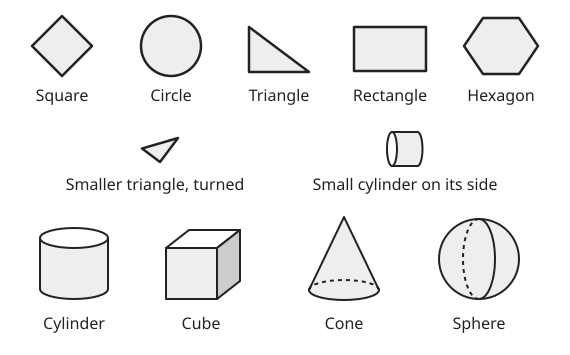

# Shapes on a classroom shelf

Kindergarten · Shape names, positions and attributes

## Which shape do you see?

**[K.G.A.1](https://www.thecorestandards.org/Math/Content/K/G/A/1/) and [K.G.B.4](https://www.thecorestandards.org/Math/Content/K/G/B/4/).** Look first at a flat outline, then at a whole object you could hold. Which name fits each one? The top of the drawing shows plane figures. The lower drawings are schematic views of solids. Slanting lines and curved strokes help show depth.

| Flat shape | Where to find its outline | What to follow with a finger |
|---|---|---|
| Square | Border of a square tile stood on a corner | Four straight sides of equal length and four square corners (right angles). |
| Circle | Rim of a round lid seen straight on | A round boundary all the way around, equally far from the center, with no corners. |
| Triangle | Three-sided outline of a pennant | Three straight sides meeting at three corners to close the figure. |
| Rectangle | Border of a rectangular name card | Four straight sides and four square corners. The pictured rectangle has two longer and two shorter sides. A square also meets the rectangle rule. |
| Hexagon | Outline of a six-sided floor tile | Six straight sides and six corners around one closed figure. |

| Whole solid | Object it models | What you can see or feel on the model |
|---|---|---|
| Cylinder | A straight-sided round can | Two flat circular ends of the same size with a curved surface between them. |
| Cube | A cubical block | Six equal square faces. Along each edge two faces meet. Three faces meet at each corner. |
| Cone | A solid model of a cone-shaped party hat | One flat circular base and a curved surface narrowing to one tip. |
| Sphere | A ball | One curved surface all the way around, with no flat face or corner. The curved line drawn on the ball helps show the turn of its surface. |

## Where is it?

**[K.G.A.1](https://www.thecorestandards.org/Math/Content/K/G/A/1/).** From the front of the shelf, the can stands **beside** the block, as the cylinder stands beside the cube in the drawing. The block is **next to** the can. Suppose the lid hangs directly over the can. The lid is **above the can** and the can is **below the lid**. Set the ball between you and the block. The ball is **in front of the block** and the block is **behind the ball** from your viewpoint. In each pair of sentences, switch the named objects and check what happens to the position word.

## Turn it or make it smaller

**[K.G.A.2](https://www.thecorestandards.org/Math/Content/K/G/A/2/) and [K.G.B.4](https://www.thecorestandards.org/Math/Content/K/G/B/4/).** Compare the two triangles. The large pennant has a level bottom side. In the smaller copy all three sides slant. Trace around either one. Three straight sides close up at three corners. Turning and shrinking it preserved those features, so both are **triangles**. Turn the pictured square until a side is level. Its four equal sides still meet at four square corners.

The large cylinder in the bottom row stands on one end. The smaller cylinder in the middle row lies on its side. Both still have two flat circular ends. A cube, turned onto a different face, still has six flat square faces. A cylinder and a cube can both rest on a flat face. Only the cylinder also has a curved side.

## The face and the whole

**[K.G.A.3](https://www.thecorestandards.org/Math/Content/K/G/A/3/).** Trace around one circular end of the can on paper. The line encloses a flat circular region. A *plane figure* fits in a flat plane. The whole can extends back from that end and takes up space in three dimensions, as does the ball. A circle drawing and a sphere model can have the same round outline when viewed straight on. Turn the ball in your hand and its curved surface continues around the back.

**Parent bridge.** “Circle” answers a question about the shape of the can's flat end. “Cylinder” names the whole can, including the other end and the curved surface joining them.
