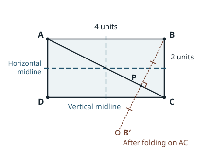

# Which folds match this rectangle?

Grade 4 · Goal G61 · Standard 4.G.A.3 · Concepts `symmetry`, `shape` · Practice MP3

Common Core 4.G.A.3 asks students to recognize and draw folds that make the parts of a flat figure match. [Common Core State Standards for Mathematics, p. 32](https://corestandards.org/wp-content/uploads/2023/09/ADA-Compliant-Math-Standards.pdf#page=32)

A **line of symmetry** is a line you can fold along so the entire shape on one side lands exactly on the shape on the other side. Points on the fold stay in place. Each other point lands the same distance straight across the fold, measured at a right angle to the fold line.

The rectangle is drawn to scale, 4 units across and 2 units tall. Its corners are A at the upper left, B at the upper right, C at the lower right and D at the lower left. Which of the two midlines and the diagonal AC are lines of symmetry? Are there any other lines of symmetry?

## Test the folds

The **horizontal midline** runs from the middle of AD to the middle of BC, 1 unit below the top. A and D trade places, and B and C trade places. The top edge lands on the bottom edge and the bottom edge lands on the top. Each vertical edge folds onto itself, with its top half landing on its bottom half. Away from the crease, each point lands at the same left-to-right position on the opposite side of the fold.

The **vertical midline** runs from the middle of AB to the middle of DC, 2 units from the left. A and B trade places, and D and C trade places. The left edge lands on the right edge and the right edge lands on the left. Each horizontal edge folds onto itself, with its left half landing on its right half. Away from the crease, each point lands at the same height on the opposite side of the fold.

The **diagonal AC** goes from the upper left corner to the lower right corner. A and C stay in place. For the corners to match, B would have to land on D, the only corner across the fold. B is 4 units from A, and D is 2 units from A. A fold keeps the distance to A the same, so B misses D. To draw where B lands, draw a line from B that meets AC at a right angle at P. Continue past P for the same distance as BP. The new point B′ is below the bottom edge. The matching tick marks on BP and PB′ show the two equal distances.

## Check for other folds

A matching fold takes corners to corners and keeps side lengths the same. The 4-unit top edge must land either on itself or on the 4-unit bottom edge.

- If the top edge lands on itself, its corners either trade places or both stay in place. Trading places requires a crease halfway between A and B at a right angle to the top edge, giving the vertical midline. If both corners stay in place, the crease would run along the top edge and flip the whole rectangle above it.
- If the top edge lands on the bottom edge, the middle of the top edge lands on the middle of the bottom edge. The crease must pass halfway between those midpoints at a right angle to the segment joining them, giving the horizontal midline.

The rectangle has **exactly two lines of symmetry**, the horizontal and vertical midlines.

## Parent bridge

The diagonal cuts the rectangle into triangles of equal area. Turning the rectangle half a turn around its center swaps A with C and B with D, so one triangle covers the other. A fold along AC keeps A and C in place and sends corner B past the bottom edge. Equal area tells how much space each piece covers. A line of symmetry makes the pieces match along every edge when you fold.
